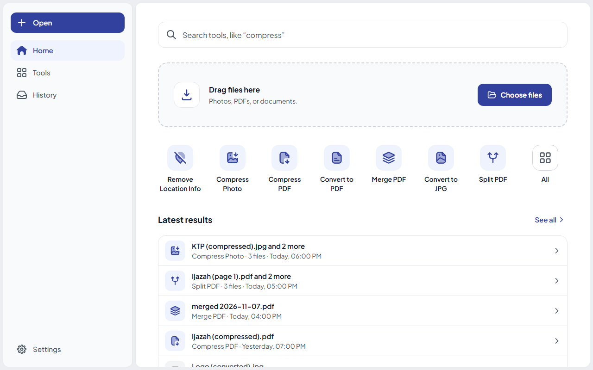
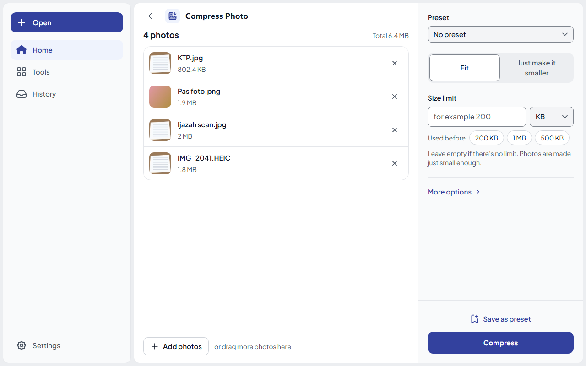
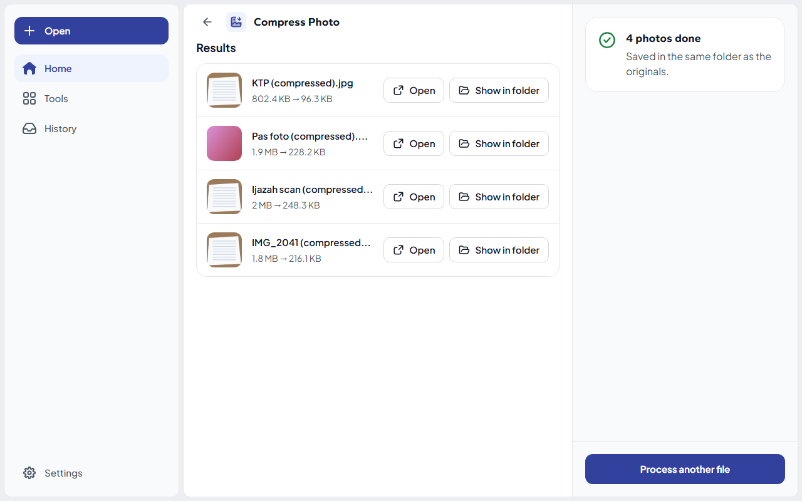
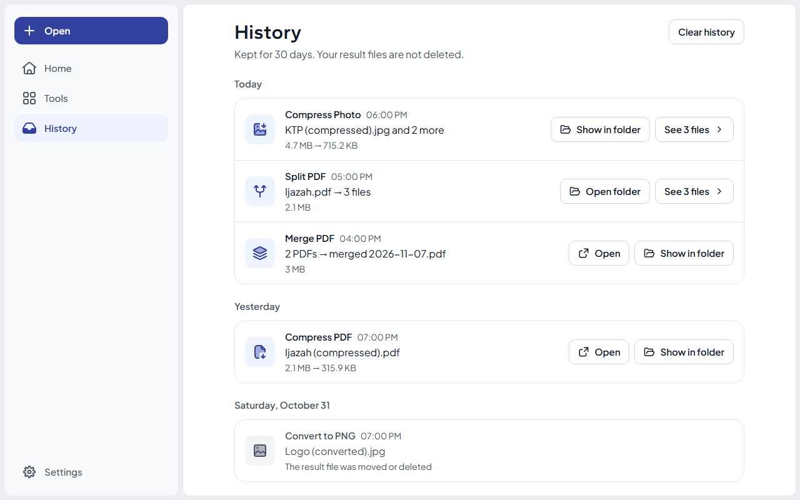
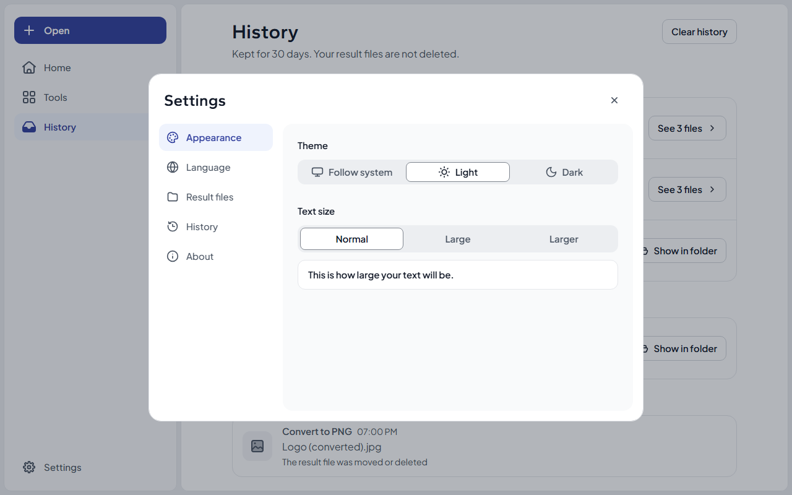
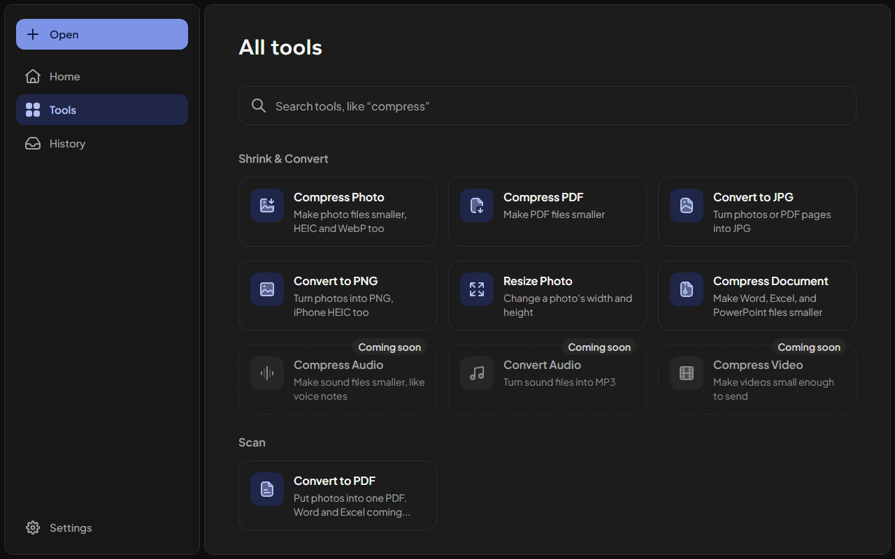
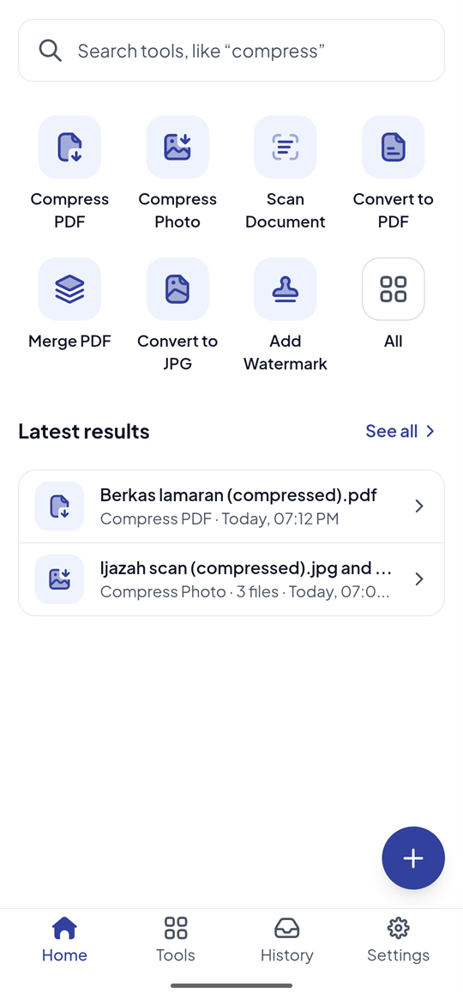
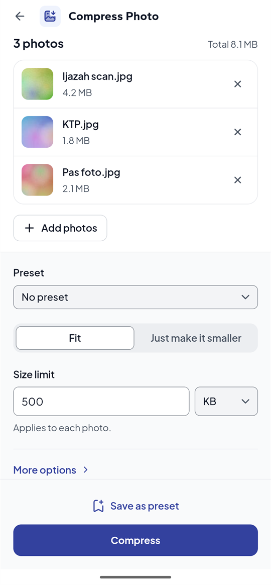
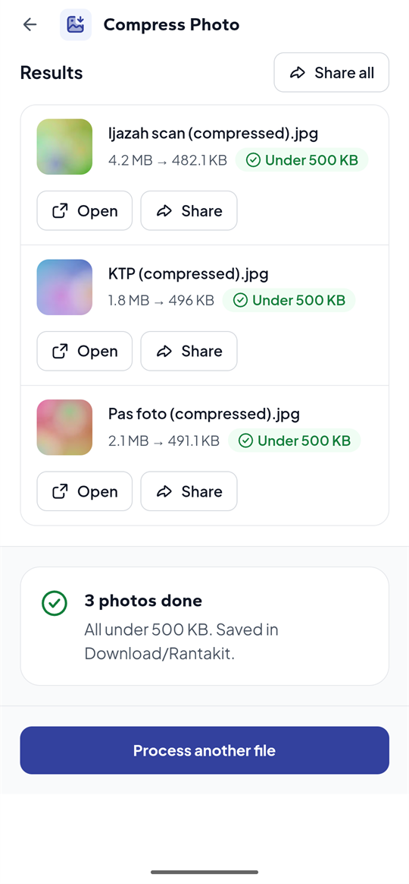
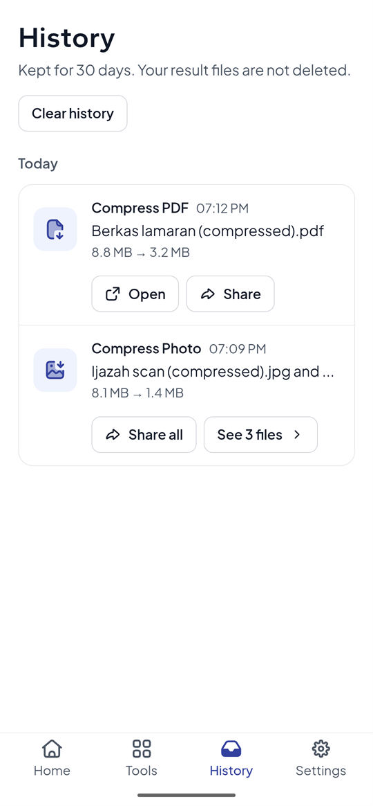

<div align="center">
  
  <h1>Rantakit</h1>

  <p><strong>All your file tools, no internet needed, free & open source.</strong></p>

  <p>
    
    
  </p>
</div>

<p align="center">
  English |
  <a href="docs/readme/README.id.md">Bahasa Indonesia</a>
</p>

---

Rantakit is free, open source file toolkit, it keeps everything you need in one place: compress files, convert formats, work in PDFs, scan documents, and extract text out of images.

Everything runs on your device. That means it works with no internet connection.

> [!WARNING]
> Rantakit is in early development and is not stable yet. Features and behavior may change at any time.

## Screenshots

### Windows and Linux

<table>
  <tr>
    <td width="50%"><br /><sub><b>Home</b></sub></td>
    <td width="50%"><br /><sub><b>Compress Photo</b></sub></td>
  </tr>
  <tr>
    <td width="50%"><br /><sub><b>Results</b></sub></td>
    <td width="50%"><br /><sub><b>History</b></sub></td>
  </tr>
  <tr>
    <td width="50%"><br /><sub><b>Settings</b></sub></td>
    <td width="50%"><br /><sub><b>All tools</b></sub></td>
  </tr>
</table>

### Android

<table>
  <tr>
    <td width="25%"><br /><sub><b>Home</b></sub></td>
    <td width="25%"><br /><sub><b>Compress Photo</b></sub></td>
    <td width="25%"><br /><sub><b>Results</b></sub></td>
    <td width="25%"><br /><sub><b>History</b></sub></td>
  </tr>
</table>

## Roadmap

The features Rantakit has and plans, by release. Releases have no dates; see [ROADMAP.md](ROADMAP.md) for details.

| Version       | Feature                    | Short description                                                  |
| ------------- | -------------------------- | ------------------------------------------------------------------ |
| v0.1          | Batch processing           | Work on many files at once (already in preview)                    |
| v0.2          | Compress image             | Make photos smaller, by size limit or "just make it smaller"       |
| v0.2          | Compress PDF               | Make PDFs small enough for upload portals                          |
| v0.2          | Image format conversions   | Convert photos between JPG and PNG                                 |
| v0.2          | History of recent jobs     | Riwayat (History) of past Tasks, kept for 30 days                  |
| v0.2          | Windows and Linux support  | Desktop release with the new look, in Indonesian and English       |
| v0.3          | Android support            | The same Tools on low-end phones, with Share → Rantakit            |
| v0.4          | Merge PDFs                 | Combine several PDFs into one                                      |
| v0.4          | Split PDFs                 | Cut one PDF into several                                           |
| v0.4          | Extract PDF pages          | Save chosen pages as a new PDF                                     |
| v0.4          | Rotate PDF pages           | Turn pages the right way up                                        |
| v0.4          | Reorder PDF pages          | Change the order of pages                                          |
| v0.4          | Images to PDF              | Turn photos into one PDF, with crop and straighten                 |
| v0.4          | Capture documents          | Scan paper with the camera into a clean PDF (Android)              |
| v0.4          | Add watermark              | Mark ID copies for one purpose only, on photos and PDFs            |
| v0.4          | Remove location info       | Remove location and camera info from photos before sharing         |
| v0.4          | Image format conversions   | Convert HEIC and WebP photos to JPG or PNG                         |
| v0.4          | PDF to images              | Turn PDF pages into JPG images                                     |
| v0.4          | Compress office document   | Make Word, Excel, and PowerPoint files smaller                     |
| v0.5          | Compress audio             | Make audio files such as voice notes smaller                       |
| v0.6          | Compress video             | Make videos small enough to send or upload                         |
| After 1.0     | Extract text from images   | Get text out of images and PDFs, in Indonesian and English         |
| Not scheduled | Compress GIF               | Not in the roadmap yet                                             |
| Not scheduled | macOS and iOS support      | Not in the roadmap yet                                             |

The roadmap is not fixed. Suggestions from anyone are welcome: if there is a feature that would make Rantakit more useful for you, please [open an issue](https://github.com/moez-rd/rantakit/issues) and tell us about it. Your ideas help decide what Rantakit builds next.

## Install

Download the latest version from the [Releases page](https://github.com/moez-rd/rantakit/releases).

| OS                  | File                                               |
| ------------------- | -------------------------------------------------- |
| Windows             | `Rantakit_<version>_x64-setup.exe` (or the `.msi`) |
| Debian, Ubuntu      | `Rantakit_<version>_amd64.deb`                     |
| Fedora, openSUSE    | `Rantakit-<version>-1.x86_64.rpm`                  |
| Other Linux distros | `Rantakit_<version>_amd64.AppImage`                |
| Android             | `Rantakit_<version>_arm64.apk`                     |
| Older Android       | `Rantakit_<version>_armv7.apk`                     |

**Windows:** the installer is not code-signed yet, so Windows SmartScreen may show "Windows protected your PC". Click **More info**, then **Run anyway**.

**Linux (.deb):** `sudo apt install ./Rantakit_<version>_amd64.deb`

**Linux (AppImage):** run `chmod +x` on the file, then open it. On Ubuntu 22.04 and newer, AppImages also need `libfuse2` (`sudo apt install libfuse2`).

**Android:** almost every phone since 2017 takes the arm64 APK. If Android says the app isn't compatible with your phone, use the armv7 one. Opening the APK asks you to allow installs from your browser or Files app the first time. A newer APK installs over the old one and keeps History, Presets, and Settings.

macOS has not have release yet. You can also [build from source](#build-from-source).

## Build from source

**Prerequisites**

- Rust (stable), https://rustup.rs
- [Bun](https://bun.sh)
- Tauri prerequisites for your platform, https://tauri.app/start/prerequisites/

**Run**

```bash
bun install
bun run tauri dev       # development
bun run tauri build     # production bundle
```

**Android**

Needs Android Studio with an SDK, the NDK (Side by side), and the SDK Command-line Tools, plus the Rust targets:

```bash
rustup target add aarch64-linux-android armv7-linux-androideabi x86_64-linux-android i686-linux-android
```

Set `JAVA_HOME` (Android Studio's `jbr`), `ANDROID_HOME`, and `NDK_HOME`. On Windows, turn on Developer Mode, since the build links the Rust library into the Android project. tauri-cli 2.12 can't tell how `bun run` started it, so call the CLI directly and name bun:

```bash
npm_execpath="$(which bun)" bun node_modules/@tauri-apps/cli/tauri.js android build --debug --apk --target x86_64
```

The emulator, and any phone, needs Android System WebView 111 or later; older ones show how to update it.

**Checks**

```bash
bun run build                         # type-check and build the frontend
cargo test --workspace                # Rust tests
cargo clippy --workspace --all-targets
```

## Project structure

```
crates/rantakit-core/    engine contract: error kinds, progress, cancel
crates/rantakit-image/   image engine (JPG and PNG), no Tauri dependency
crates/rantakit-pdf/     PDF engine, no Tauri dependency
crates/rantakit-office/  Word, Excel, and PowerPoint engine, no Tauri dependency
crates/rantakit-tasks/   Tasks, Result names, Tool catalogue, History, no Tauri dependency
src-tauri/               desktop app: commands, native menu
src/                     React frontend
```

## Tech stack

Tauri 2, Rust, [`image`](https://crates.io/crates/image), [`lopdf`](https://crates.io/crates/lopdf), React 19, TypeScript, Vite, Tailwind v4, React Aria Components.

## Contributing

Issues and pull requests are welcome. Read [CONTRIBUTING.md](CONTRIBUTING.md) for how to set up, run the checks, and send a pull request.

## License

Rantakit is free software, licensed under the [GNU Affero General Public License v3.0 or later](LICENSE) (`AGPL-3.0-or-later`).
