<div align="center">
  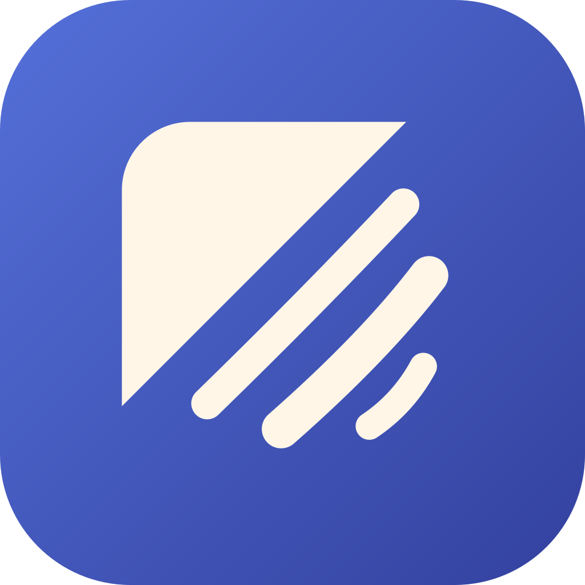
  <h1>Rantakit</h1>

  <p><strong>Semua alat berkas, tanpa internet, gratis & open source.</strong></p>

  <p>
    
    
  </p>
</div>

<p align="center">
  <a href="../../README.md">English</a> |
  Bahasa Indonesia
</p>

---

Rantakit adalah kotak alat berkas yang gratis dan open source. Semua yang kamu butuhkan ada di satu tempat: kompres berkas, ubah format, olah PDF, pindai dokumen, dan ambil teks dari gambar.

Semua proses berjalan di perangkatmu, jadi aplikasi tetap berfungsi tanpa koneksi internet.

> [!WARNING]
> Rantakit masih dalam tahap awal pengembangan dan belum stabil. Fitur dan perilaku aplikasi bisa berubah sewaktu-waktu.

## Tangkapan layar

### Windows dan Linux

<table>
  <tr>
    <td width="50%">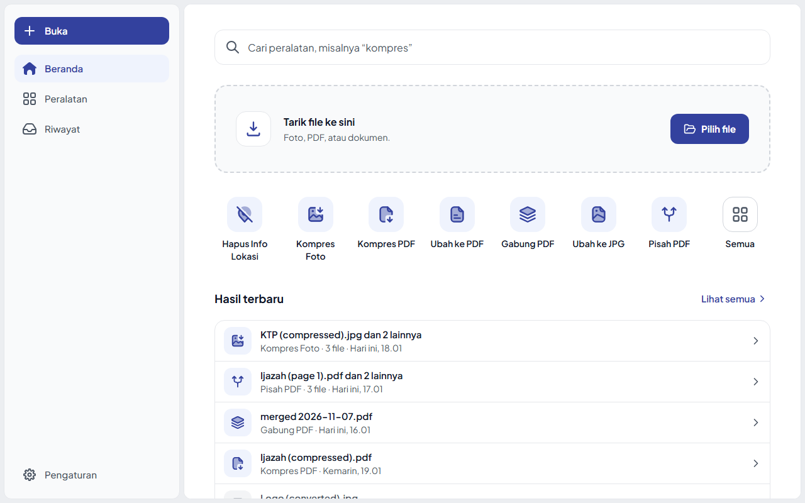<br /><sub><b>Beranda</b></sub></td>
    <td width="50%">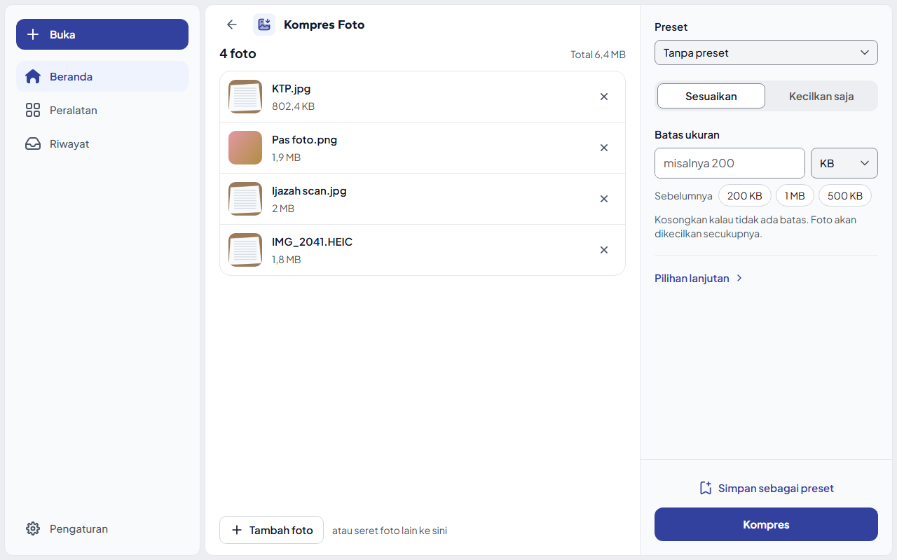<br /><sub><b>Kompres Foto</b></sub></td>
  </tr>
  <tr>
    <td width="50%">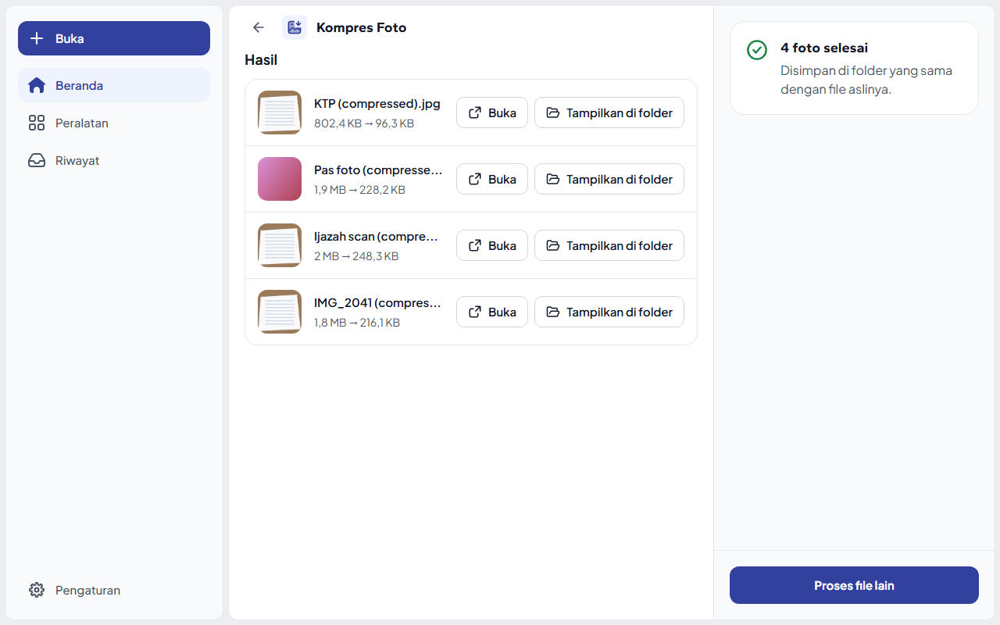<br /><sub><b>Hasil</b></sub></td>
    <td width="50%">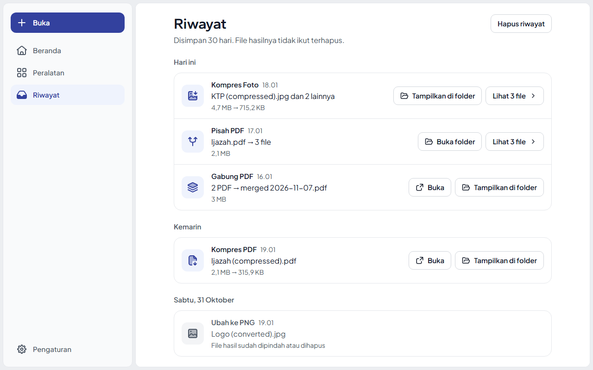<br /><sub><b>Riwayat</b></sub></td>
  </tr>
  <tr>
    <td width="50%">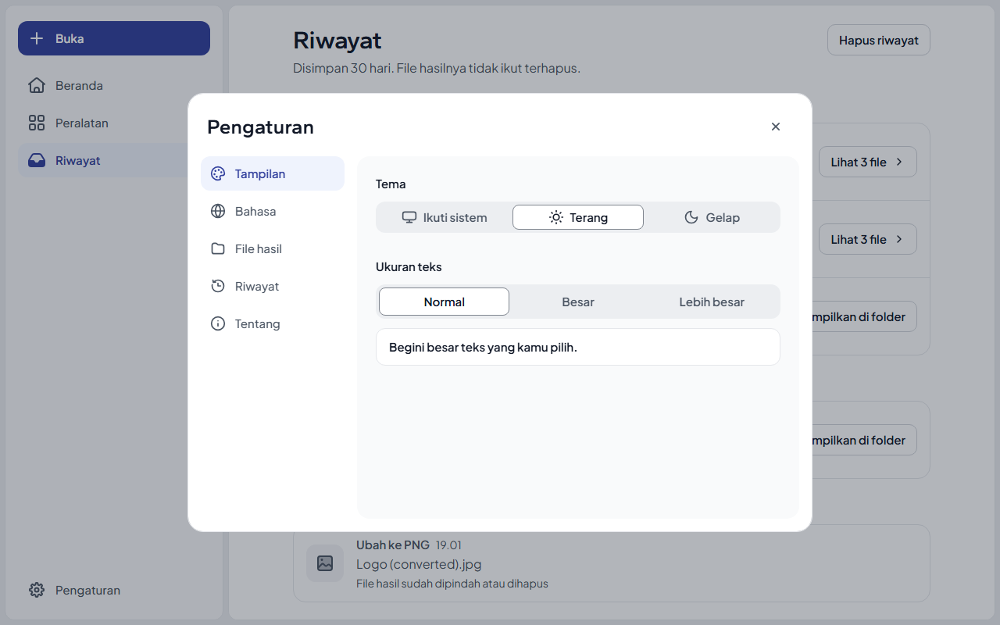<br /><sub><b>Pengaturan</b></sub></td>
    <td width="50%">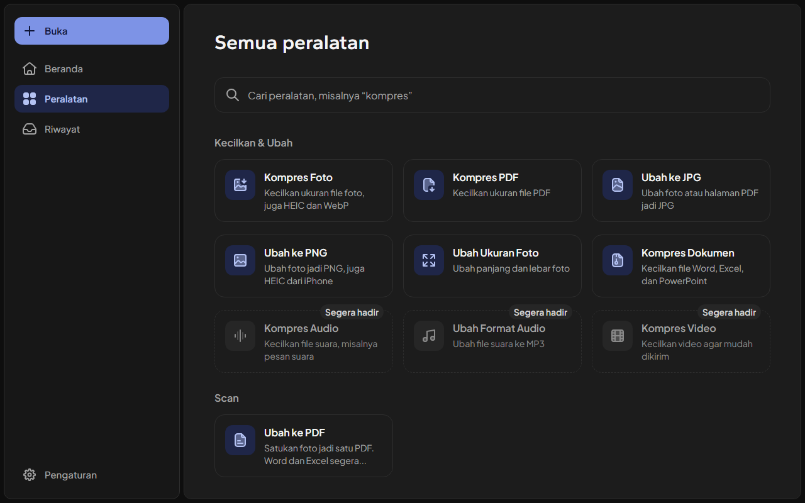<br /><sub><b>Semua peralatan</b></sub></td>
  </tr>
</table>

### Android

<table>
  <tr>
    <td width="25%">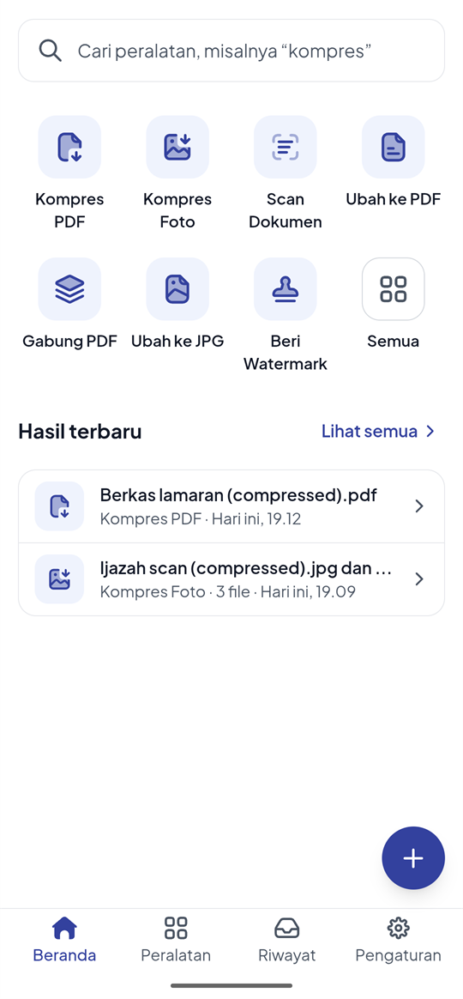<br /><sub><b>Beranda</b></sub></td>
    <td width="25%">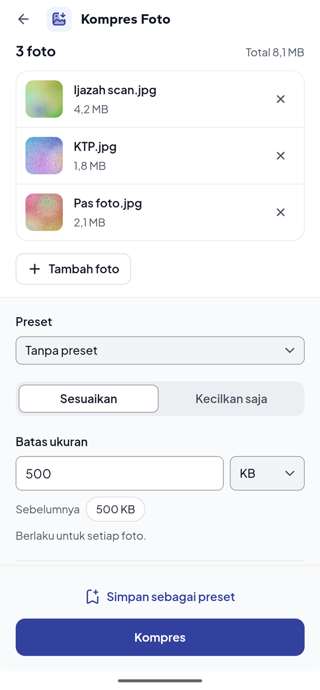<br /><sub><b>Kompres Foto</b></sub></td>
    <td width="25%">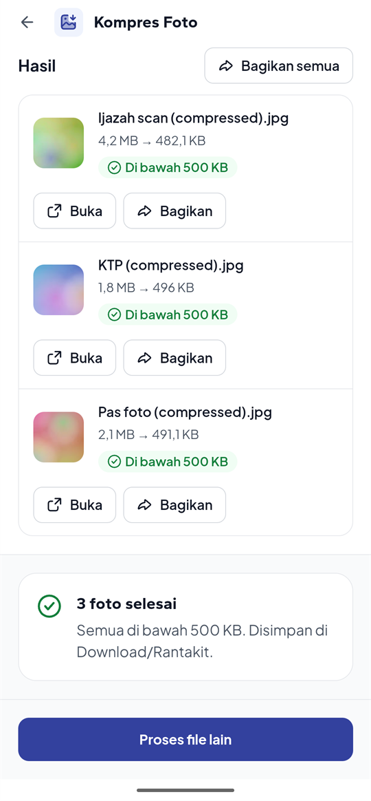<br /><sub><b>Hasil</b></sub></td>
    <td width="25%">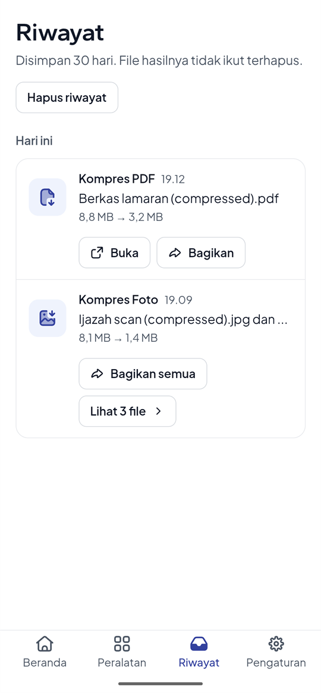<br /><sub><b>Riwayat</b></sub></td>
  </tr>
</table>

## Rencana pengembangan

Fitur yang sudah ada dan yang direncanakan, menurut rilis. Rilis tidak punya tanggal; lihat [ROADMAP.md](../../ROADMAP.md) (bahasa Inggris) untuk detailnya.

| Versi            | Fitur                          | Penjelasan singkat                                                     |
| ---------------- | ------------------------------ | ---------------------------------------------------------------------- |
| v0.1             | Proses banyak berkas sekaligus | Olah banyak berkas dalam sekali jalan (sudah tersedia sebagai pratinjau) |
| v0.2             | Kompres gambar                 | Perkecil foto sesuai batas ukuran, atau "kecilkan saja"                |
| v0.2             | Kompres PDF                    | Perkecil PDF supaya bisa diunggah ke portal                            |
| v0.2             | Konversi format gambar         | Ubah foto antara JPG dan PNG                                           |
| v0.2             | Riwayat proses terbaru         | Riwayat proses sebelumnya, disimpan selama 30 hari                     |
| v0.2             | Dukungan Windows dan Linux     | Rilis desktop dengan tampilan baru, dalam bahasa Indonesia dan Inggris |
| v0.3             | Dukungan Android               | Alat yang sama di HP spesifikasi rendah, bisa dibuka lewat Bagikan     |
| v0.4             | Gabung PDF                     | Satukan beberapa PDF jadi satu                                         |
| v0.4             | Pisah PDF                      | Pecah satu PDF jadi beberapa                                           |
| v0.4             | Ambil halaman PDF              | Simpan halaman pilihan sebagai PDF baru                                |
| v0.4             | Putar halaman PDF              | Putar halaman supaya tidak terbalik                                    |
| v0.4             | Urutkan ulang halaman PDF      | Ubah urutan halaman                                                    |
| v0.4             | Gambar ke PDF                  | Jadikan foto satu PDF, dengan potong dan luruskan                      |
| v0.4             | Pindai dokumen                 | Pindai kertas dengan kamera jadi PDF yang rapi (Android)               |
| v0.4             | Beri watermark                 | Tandai salinan KTP hanya untuk satu keperluan, di foto dan PDF         |
| v0.4             | Hapus info lokasi              | Hapus info lokasi dan kamera dari foto sebelum dibagikan               |
| v0.4             | Konversi format gambar         | Ubah foto HEIC dan WebP ke JPG atau PNG                                |
| v0.4             | PDF ke gambar                  | Ubah halaman PDF jadi gambar JPG                                       |
| v0.4             | Kompres dokumen Office         | Perkecil berkas Word, Excel, dan PowerPoint                            |
| v0.5             | Kompres audio                  | Perkecil berkas audio, misalnya pesan suara                            |
| v0.6             | Kompres video                  | Perkecil video supaya bisa dikirim atau diunggah                       |
| Setelah 1.0      | Ambil teks dari gambar         | Ambil teks dari gambar dan PDF, dalam bahasa Indonesia dan Inggris     |
| Belum dijadwalkan | Kompres GIF                   | Belum masuk rencana pengembangan                                       |
| Belum dijadwalkan | Dukungan macOS dan iOS        | Belum masuk rencana pengembangan                                       |

Rencana ini belum tetap. Saran dari siapa pun sangat diterima: kalau ada fitur yang bisa membuat Rantakit lebih berguna buatmu, silakan [buka issue](https://github.com/moez-rd/rantakit/issues) dan ceritakan idemu. Masukanmu ikut menentukan apa yang dibangun Rantakit berikutnya.

## Instalasi

Unduh versi terbaru dari [halaman Releases](https://github.com/moez-rd/rantakit/releases).

| OS                | Berkas                                         |
| ----------------- | ---------------------------------------------- |
| Windows           | `Rantakit_<versi>_x64-setup.exe` (atau `.msi`) |
| Debian, Ubuntu    | `Rantakit_<versi>_amd64.deb`                   |
| Fedora, openSUSE  | `Rantakit-<versi>-1.x86_64.rpm`                |
| Distro Linux lain | `Rantakit_<versi>_amd64.AppImage`              |
| Android           | `Rantakit_<versi>_arm64.apk`                   |
| Android lama      | `Rantakit_<versi>_armv7.apk`                   |

**Windows:** installer belum ditandatangani (*code signing*), jadi Windows SmartScreen mungkin menampilkan "Windows protected your PC". Klik **More info**, lalu **Run anyway**.

**Linux (.deb):** `sudo apt install ./Rantakit_<versi>_amd64.deb`

**Linux (AppImage):** jalankan `chmod +x` pada berkasnya, lalu buka. Di Ubuntu 22.04 ke atas, AppImage juga butuh `libfuse2` (`sudo apt install libfuse2`).

**Android:** hampir semua HP sejak 2017 memakai APK arm64. Kalau Android bilang aplikasinya tidak cocok dengan HP kamu, pakai yang armv7. Saat APK dibuka pertama kali, kamu akan diminta mengizinkan pemasangan dari browser atau aplikasi Files. APK yang lebih baru dipasang di atas yang lama, dan Riwayat, Preset, serta Setelan tetap ada.

macOS belum ada rilis. Kamu juga bisa [build dari kode sumber](#build-dari-kode-sumber).

## Build dari kode sumber

**Prasyarat**

- Rust (stable), https://rustup.rs
- [Bun](https://bun.sh)
- Prasyarat Tauri untuk platformmu, https://tauri.app/start/prerequisites/

**Menjalankan**

```bash
bun install
bun run tauri dev       # pengembangan
bun run tauri build     # bundle produksi
```

**Pengecekan**

```bash
bun run build                         # cek tipe dan build frontend
cargo test --workspace                # tes Rust
cargo clippy --workspace --all-targets
```

## Struktur proyek

```
crates/rantakit-core/    kontrak mesin: jenis error, progres, pembatalan
crates/rantakit-image/   mesin gambar (JPG dan PNG), tanpa dependensi Tauri
crates/rantakit-pdf/     mesin PDF, tanpa dependensi Tauri
crates/rantakit-tasks/   tugas, nama file hasil, katalog alat, riwayat, tanpa dependensi Tauri
src-tauri/               aplikasi desktop: command, menu native
src/                     frontend React
```

## Teknologi

Tauri 2, Rust, [`image`](https://crates.io/crates/image), [`lopdf`](https://crates.io/crates/lopdf), React 19, TypeScript, Vite, Tailwind v4, React Aria Components.

## Berkontribusi

Issue dan pull request sangat diterima. Baca [CONTRIBUTING.md](../../CONTRIBUTING.md) (dalam bahasa Inggris) untuk cara menyiapkan proyek, menjalankan pemeriksaan, dan mengirim pull request.

## Lisensi

Rantakit adalah perangkat lunak bebas yang dirilis di bawah [GNU Affero General Public License v3.0 atau versi yang lebih baru](../../LICENSE) (`AGPL-3.0-or-later`).
